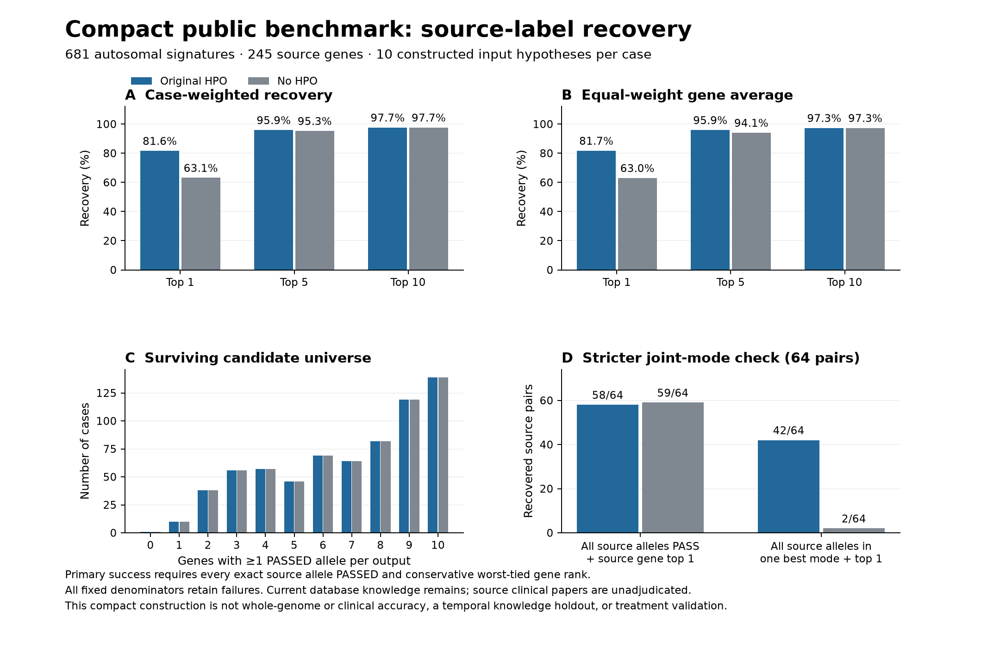

# Compact public source-label benchmark

**24 October 2026. All 1,418 executable jobs completed. All 713 planned source signatures remain in each arm’s ledger, including four preparation failures.** This companion uses ten constructed hypotheses per case. It complements the [two-background genomic study](public-validation.md); it is not an additional whole-genome or clinical validation cohort. **[OUR MEASUREMENT; scope defined before inference]**

The prespecified primary endpoint is source-gene top-1 among genes with at least one PASSED allele, with **every exact source allele represented in that gene and PASSED**. Ties use the worst tied rank. The primary stratum contains 681 autosomal signatures and 245 source genes. The 32 X signatures remain separate technical controls; four female/hemizygous ambiguities were retained as preparation failures without changing their source genotypes. **[OUR MEASUREMENT — frozen case ledger and protocol]**

The corrected, independently reproduced primary results are:

- **Original HPO: 556/653/665 of 681 at top-1/5/10**; top-1 81.64%; case MRR 0.873546. Giving each of 245 source genes equal weight yields top-1 81.75% and gene-macro MRR 0.875453. **[OUR MEASUREMENT]**
- **No HPO: 430/649/665 of 681 at top-1/5/10**; top-1 63.14%; case MRR 0.752084. Giving each of 245 source genes equal weight yields top-1 63.01% and gene-macro MRR 0.748031. **[OUR MEASUREMENT]**

Original-minus-no-HPO top-1 is **+18.50 percentage points** by case and **+18.74 points** by equal-weight gene average. This comparison concerns the fixed synthetic candidate sets and current knowledge; it does not estimate clinical diagnostic accuracy or rank competing models. **[OUR MEASUREMENT; OUR INFERENCE about scope]**

The portable bundle retains raw output JSONL files, hashes, source inputs as a case ledger, frozen protocols, the original and corrected evaluations, and a separate offline verifier. The independent audit checks the local raw execution and both evaluations; neither offline verification nor the figure reruns Exomiser inference. [Portable verification instructions](../examples/compact-benchmark/README.md).

## Candidate sets and source qualifications

Each source hypothesis was combined with nine benign-labelled hypotheses assigned to distinct intended genes. Single-allele decoys match variant type and consequence when available; 18 cases retain documented fallback matching. Two-allele decoys are synthetic unphased pairs, whose combined haplotype is not clinically validated. The construction contains 7,130 input hypotheses, 7,770 allele occurrences and 6,010 distinct reference-checked alleles, with zero reference mismatches. Annotation and filtering can expand or shrink the gene universe. **[OUR MEASUREMENT — frozen preparation receipts]**

Both arms have the same candidate-count distribution across all 713 planned cases: **708 nonempty outputs with one to ten PASSED genes, one empty output, and four preparation failures with no output**. Exactly 145 outputs per arm retain ten genes. The figure displays the primary autosomal distribution; the JSON audit retains every case and the complete distribution. **[OUR MEASUREMENT]**

Consequently, top-ten recovery must be read with the surviving candidate counts. It still requires all exact source alleles to pass, but is a weak ranking test when ten or fewer genes survive. Case and gene-macro summaries retain every failure rather than reporting accuracy only among recoverable cases. **[OUR INFERENCE]**

The selected-source ledger spans **322 publications**; alternate packets add **12**, making **334** in the fixed review inventory. The [24 October 19:46 UTC review snapshot](../examples/compact-source-audit/README.md) contains **253 valid records, 241 full-main-text reads and 130 all-component paper reviews**. It adjudicates **1,072/1,389 packet mappings**; **272/713 case signatures** have every linked selected/alternate packet and its paper components complete. Partial reviews and unresolved conclusions remain explicit. **[OUR MEASUREMENT — frozen review snapshot]**

This source audit was designed **after inference**, is **not preregistered**, and discloses each reviewer's prior outcome exposure. It adds a separate annotation layer; no original label, cohort member, endpoint or score was changed. A source disagreement can concern one phenotype or classification annotation without disproving the diagnosis. Complete source review is not independent clinical validation. The portable verifier checks shipped hashes, input bindings, mappings and counts; original source articles are not redistributed and their content is not revalidated offline. The initial crosscheck finding 321 papers absent from the older reading ledger is historical, superseded by this snapshot for review progress. **[OUR MEASUREMENT; OUR INFERENCE about scope]**

This is our independently reconstructed 713-signature / 261-gene cohort, not the authors’ unresolved 719-case / 265-gene cohort. The 2512 Exomiser databases retain current disease/gene/HPO knowledge, despite disabling the ClinVar whitelist. There is no temporal model-knowledge holdout. Lexical representative contexts differ across alternative source records for 230 signatures; 79 retain multigene/missing ClinVar annotation and 30 retain unknown source sex. These qualifications were preserved before inference. **[OUR MEASUREMENT — frozen case ledger; OUR INFERENCE about scope]**

## Every fixed stratum and the stricter joint-mode endpoint

Full-source-allele top-1/5/10 counts, original HPO then no HPO, retain the following fixed denominators. These strata overlap and must not be added together. **[OUR MEASUREMENT]**

- All source signatures: **original HPO 581/681/693; no HPO 449/677/693**, each over 713 signatures and 261 source genes. **[OUR MEASUREMENT]**
- Primary autosomal: **original HPO 556/653/665; no HPO 430/649/665**, each over 681 signatures and 245 source genes. **[OUR MEASUREMENT]**
- Technical X: **original HPO 25/28/28; no HPO 19/28/28**, each over 32 signatures and 16 source genes. **[OUR MEASUREMENT]**
- Fallback matching: **original HPO 12/13/14; no HPO 6/9/14**, each over 18 signatures and 13 source genes. **[OUR MEASUREMENT]**
- Without fallback matching: **original HPO 569/668/679; no HPO 443/668/679**, each over 695 signatures and 257 source genes. **[OUR MEASUREMENT]**
- Two-allele source signatures: **original HPO 58/64/64; no HPO 59/64/64**, each over 64 signatures and 41 source genes. **[OUR MEASUREMENT]**

A separate strict endpoint additionally requires every source allele to contribute within **one individual best-scoring inheritance mode**. A union across different modes does not qualify; missing contribution evidence remains unknown. This does not establish phase or clinical joint causality. **[OUR INFERENCE; frozen endpoint definition]**

- Original HPO: strict top-1/5/10 **540/631/642 of 681** in the primary stratum; **42/45/45 of 64** among all two-allele source signatures. **[OUR MEASUREMENT]**
- No HPO: strict top-1/5/10 **373/588/604 of 681** in the primary stratum; **2/3/3 of 64** among all two-allele source signatures. **[OUR MEASUREMENT]**

The machine-readable evaluations additionally retain gene-only ranking, any/every tied-best-mode flags, exact per-allele filter/contribution evidence, all case and gene-macro top-k/MRR metrics, and every original-minus-no-HPO delta. A missing allele in PASS_ONLY output does not identify the filtering stage or biological cause.

## Explicit post-freeze parser correction

The frozen helper treated an absent inheritance-mode `combinedScore` as invalid. Installed Exomiser represents that field as primitive double and serializes with `NON_DEFAULT`, suppressing zero. A direct Java probe with the installed class and writer configuration confirms zero suppression and nonzero retention. The separately versioned correction defaults only an absent mode score to zero; explicit null/nonfinite/bool scores remain invalid. No input, label, inclusion rule, endpoint, tie rule or denominator changed. The original implementation and literal evaluation remain distributed. **[OUR MEASUREMENT — installed-bytecode and empirical serialization evidence]**

The independent audit identifies **726 case/arm outputs** affected by this parser defect. Before correction, primary full-source-allele top-1/5/10 was **547/626/632 of 681** with original HPO and **0/0/0 of 681** without HPO. The original and corrected results must be read together. This is a disclosed post-freeze implementation correction, not a newly preregistered analysis. **[OUR MEASUREMENT]**

Four source cases carry HPO mapping warnings: one NAV3 and three NLRP7 cases. Their full unchanged HPO lists, warning text and runtime context remain in the audit. No term was replaced and no case excluded. A dry-run warning alone does not prove whether the downstream scorer used the unrecognized term. **[OUR MEASUREMENT]**

No result in this companion demonstrates N1002K function, arimoclomol rescue, clinical benefit, or superiority over a competing proposal. Those questions require evidence beyond ranking public source labels. **[OUR INFERENCE]**
