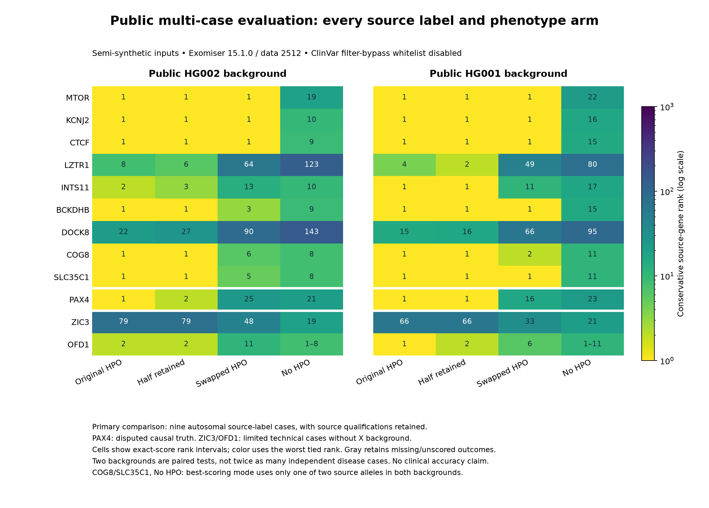

# Public multi-case evaluation: reproducibility, phenotype perturbation and source support

**24 October 2026. Both genomic batches and the repaired phenotype-only comparator are complete: 96 genomic jobs across two public backgrounds, plus 12 phenotype-only jobs.**

This evaluation asks whether the retained pipeline executes across literature-derived genes, how source-gene rankings change when phenotype input changes, and whether recovery persists on two public genome backgrounds. It uses semi-synthetic combinations of published alleles and public GIAB variants. It does not measure prospective diagnostic accuracy or drug efficacy. **[OUR MEASUREMENT]**

With original HPO profiles, source-gene top-1/5/10 recovery is **6/7/8 of nine labels on HG002** and **7/8/8 on HG001**. Requiring recovery on both backgrounds gives **6/7/8 of the same nine labels**, not eighteen independent cases. Five labels have material source qualifications. The [paired results](../examples/public-benchmark/results/paired-summary.json), [HG002 export](../examples/public-benchmark/results/HG002/) and [HG001 export](../examples/public-benchmark/results/HG001/) retain all cases and all four phenotype arms.

The [phenotype-only comparator](../examples/public-benchmark/results/phenotype-only/evaluation.json) recovers **4/8/8 of nine**. Its top-ten count matches each genomic run, but the missed label differs. The candidate universes and filtering differ, so this is not an estimate of the causal value of sequencing.

## Selection before scoring

Phenopacket Store release 0.1.19 supplied 6,668 records. Fixed eligibility rules retained 5,109 records across 394 genes. A seeded hash order selected twelve different genes within genotype-pattern quotas: four single heterozygous autosomal cases, four homozygous autosomal cases, two cases with two heterozygous autosomal alleles, one X-heterozygous female and one X-hemizygous male. The previous FGFR2 example and BUB1B were excluded. Selection did not use Exomiser scores, predicted pathogenicity, frequency or database availability.

The [twelve selected phenopackets, source archive hash, selection code and frozen plan](../examples/public-benchmark/source-selection/README.md) are retained. All fourteen selected REF alleles match GRCh38; a separate reference-normalization check left those fourteen alleles unchanged. This does not establish causality. The two heterozygous pairs remain unphased in the constructed VCFs; source family evidence is described separately. No diagnosis or expected gene is passed as a prioritiser hint. Source identifiers remain in provenance, and HPO profiles can themselves be disease-specific.

## Primary-source adjudication

The primary comparison contains **nine autosomal source labels**: MTOR, KCNJ2, CTCF, LZTR1, INTS11, BCKDHB, DOCK8, COG8 and SLC35C1. PAX4 remains visible separately because its original report calls the allele a VUS and a primary gene-level study disputes the causal disease association. ZIC3 and OFD1 remain technical cases because neither background includes chromosome X. No case or phenotype arm was replaced after source review. A [review retained before inference](../examples/public-benchmark/source-selection/x-case-source-review.md) resolves ZIC3 polysplenia as belonging to the selected sister's brother and identifies an unresolved, non-equivalent OFD1 exact-allele conflict between paper text, sequence figure and the frozen packet. These limitations do not alter any input or swapped donor profile.

The nine primary main texts and all 39 main figures were reviewed in available versions. The BCKDHB publisher PDF was subsequently recovered; COG8 was reviewed as full publisher HTML and figure assets. Four cases support all selected positive phenotype terms. Five have material qualifications: MTOR includes a competing PKD1 explanation for renal findings; CTCF has another de novo candidate; BCKDHB uses syndrome-level phenotype projections; DOCK8 includes phenotype-specificity and case-level sequence limits; and severe intellectual disability is not established for the younger SLC35C1 proband. The [review ledger](../examples/public-benchmark/source-selection/truth-adjudication-v3.json) and [figure review](../examples/public-benchmark/source-selection/visual-followup-v1.md) retain exact coverage and remaining supplement/raw-data gaps.

A [later review](../examples/public-benchmark/source-selection/visual-followup-v2.md), completed after inference started without result access, read all CTCF case-table columns, systematically inspected its cohort-data workbook and reviewed samples spanning the full duration of all three SLC35C1 movies. The original review and its incorrect CTCF shorthand (Arg390His) remain preserved with an explicit correction to Asp390Asn; execution inputs were already correct. The later visual review also found an INTS11 table/narrative conflict about motor development; the narrative supports the retained term, with the conflict recorded. COG8 figures support trans inheritance; BCKDHB chaperone rescue concerns a different allele from this selected case. Later review is not retroactive pre-inference evidence.

Before inference, we froze both the original **4/3/2** source-support partition and the updated **4/5** map after recovering the MTOR and DOCK8 material. [Both groupings](../examples/public-benchmark/source-selection/source-support-groups-v3.json) remain in the results. They describe source support, not independently established clinical truth.

## Backgrounds and fixed analysis

GIAB v4.2.1 GRCh38 HG002 supplies 4,048,342 autosomal input records; HG001 supplies 3,893,341. We select all canonical autosomal Ensembl 116 exons across transcripts and biotypes, with 20-base flanks, without selecting disease genes. Splitting multiallelic background records yields 274,477 HG002 and 264,383 HG001 records. Each case replaces conflicting records at its source locus and inserts the frozen allele/genotype; every replacement is logged. This is not a genuine diseased genome or a claim that every background allele was reference-left-normalized. The [execution recipe](../examples/public-benchmark/README.md) explains preparation and dependencies. **[OUR MEASUREMENT — frozen preparation receipts and independent input audit]**

Exomiser 15.1.0, Java 21.0.12.1 and data bundles 2512 are pinned. Two invocation-only dry-run failures were retained and corrected before inference. A later operational restart increased the bounded cache from 60,000 to 300,000 entries; scientific job content and inputs were checked unchanged, apart from output directories. The first HG002 attempt was interrupted during job 3, preserving its two completed outputs. All 48 jobs were repeated. This was an operational amendment after inference began, not external preregistration.

The four fixed arms use original positive HPO terms, a seeded half retained, another selected case's profile, and no HPO. The first three differ only in the HPO list. The no-HPO arm also removes hiPhive; its OMIM inheritance prior remains. Shared features can persist in the swapped profile. These perturbations are not healthy controls.

The evaluation disables the ClinVar whitelist/filter bypass. Other ClinVar, HPO/OMIM and predictor-training knowledge remains. This is not a temporal holdout or a novel-gene evaluation. The [separate FGFR2 reconstruction](generalisation-public-case.md) retains its own settings and is not pooled into the twelve-case results; its missing August configuration remains unrecovered.

## Outcomes and retained evidence

Primary top-1/5/10 source-gene recovery uses the **worst rank in an exact combined-score tie**. Unscored genes and failed or missing runs remain in the denominator. Results are separate by background and paired across both; two backgrounds do not create additional independent source cases. Every scored gene is retained in a compact score export, with complete jobs, versions, hashes and execution records.

A source-allele diagnostic checks exact GRCh38 coordinates within each source-gene result, retaining filter, score-contribution and whitelist fields. An unmatched indel would require representation review. A high gene rank does not establish that every source allele contributed to its best-scoring inheritance mode, that phase was recovered or that the original disease attribution is correct.

## Completed genomic results

HG002 completed all 48 jobs on 23 October at 23:53:33 UTC; HG001 completed all 48 on 24 October at 00:54:00 UTC. Recorded execution times were 3,488.41 and 3,607.42 seconds, respectively, excluding database recovery, preparation and the separate phenotype comparator. There are no failed or missing genomic jobs and no unscored primary genes. The filtered output universes contain 470 genes per HG002 job and 344 per HG001 job. These are output gene counts, not the number of genes present in the original genomes. [HG002 execution](../examples/public-benchmark/results/HG002/execution.json); [HG001 execution](../examples/public-benchmark/results/HG001/execution.json). **[OUR MEASUREMENT]**

For each arm below, counts are ordered **top-1 / top-5 / top-10**, each with denominator **nine**:

- **Original HPO:** HG002 **6/7/8**; HG001 **7/8/8**; recovered on both **6/7/8**.
- **Half retained:** HG002 **6/7/8**; HG001 **7/8/8**; recovered on both **6/7/8**. Identical cutoff counts do not mean identical individual ranks.
- **Swapped HPO:** HG002 **3/5/6**; HG001 **5/6/6**; recovered on both **3/5/6**.
- **No HPO:** HG002 **0/0/6**; HG001 **0/0/0**; recovered on both **0/0/0**.

Original-profile ranks outside first place are INTS11 **2**, LZTR1 **8** and DOCK8 **22** on HG002; LZTR1 **4** and DOCK8 **15** on HG001. DOCK8 is outside the top ten on both backgrounds. The no-HPO results show substantial background sensitivity. These paired observations do not establish population-level diagnostic performance. [All HG002 ranks](../examples/public-benchmark/results/HG002/evaluation.json); [all HG001 ranks](../examples/public-benchmark/results/HG001/evaluation.json).



The figure retains disputed and technical cases separately from the nine primary labels. It shows gene ranks; the allele-level qualification below still applies.

### Sensitivity to source support

Under original HPO, the **four better-supported labels** (KCNJ2, LZTR1, INTS11, COG8) recover **2/3/4 of four** on HG002 and **3/4/4 of four** on HG001. The **five qualified labels** (CTCF, BCKDHB, SLC35C1, MTOR, DOCK8) recover **4/4/4 of five** on each background. These small strata prevent interpreting the aggregate count as uniformly strong source-supported recovery.

The original **4/3/2 sensitivity** is also retained: the same four-case group gives the counts above; the original qualified three (CTCF, BCKDHB, SLC35C1) recover **3/3/3 of three** on each background; the two initially incomplete source reviews (MTOR, DOCK8) recover **1/1/1 of two** on each. “Initially incomplete” describes that earlier review state; it is not a claim that those main texts remain unread. [The paired summary](../examples/public-benchmark/results/paired-summary.json) includes every phenotype arm for both partitions.

The disputed PAX4 label ranks first under original HPO on both backgrounds, illustrating that high rank does not resolve disease attribution. Technical-case original ranks are ZIC3 **79/66** and OFD1 **2/1**, in HG002/HG001 order. Neither X-case rank validates its source record or compensates for the absent chromosome-X background.

### Allele-level audit and its limit

Across both backgrounds and all four arms, all **112 source-allele observations** (14 alleles × 4 arms × 2 backgrounds) match exactly, are marked `PASSED`, and contribute under at least one reported inheritance mode. These are repeated observations of fourteen alleles, not 112 independent variants. [HG002 source-allele diagnostic](../examples/public-benchmark/results/HG002/source-variant-audit.json); [HG001 source-allele diagnostic](../examples/public-benchmark/results/HG001/source-variant-audit.json).

**A global contribution flag is insufficient to establish joint recovery.** In the no-HPO arm, COG8 and SLC35C1 each rank **8 on HG002 and 11 on HG001**, but the best-scoring autosomal-dominant mode uses **only one of their two source alleles**. Both alleles contribute under other reported modes. These four gene rankings must not be described as joint recovery of the source pair. In the original-HPO arms, the audit finds a best-scoring mode using both source alleles for each pair; the constructed genotypes remain unphased.

The [96 complete source-gene record excerpts](../examples/public-benchmark/results/source-gene-evidence/records.json) retain the raw allele and inheritance-mode evidence for every genomic job, alongside a [hash receipt](../examples/public-benchmark/results/source-gene-evidence/receipt.json). The [portable verifier](../examples/public-benchmark/source_evidence.py) reproduces exactly those four joint-best-mode exceptions. Full source JSONL hashes were checked during extraction. Offline verification checks the excerpt and component hashes, the original-file hash references in the execution records, agreement with the compact gene scores, and exact-allele/mode arithmetic. It cannot rehash a full original JSONL that is not distributed, or establish biological phase.

The raw JSON does not serialize per-allele `whiteListed` fields here; null means unavailable, not false. Bypass disabling is supported separately by the runtime properties and each log's `Loaded 0 whitelist variants`. It does not remove other database knowledge.

A separately implemented project audit read the frozen inputs and raw JSONL without importing the evaluator/exporter. It passed **113 checks, including 14 validator controls**, with zero errors; all 96 independently derived source-gene ranks agree with the evaluator. This is an independent implementation check within the project, not external blinded validation. It did not repeat source-literature adjudication or exon extraction, and hashed database receipts rather than rehashing the entire multi-gigabyte payload. The portable checks below establish export integrity and score-to-rank agreement; they do not rerun inference or reproduce every raw-output audit.

### Repeatability across the cache restart

The two completed outputs from the interrupted 60k-cache attempt and their 300k-cache repeats agree exactly on all three gene scores and full variant evaluations, ignoring list order, for all 470 genes in each output. Their full JSON differs: **469/470 and 470/470 gene p-values**, and reported phenotype evidence for **101 and 106 genes**, change in the original-HPO and half-retained comparisons, respectively. The largest absolute p-value changes are .002560 and .001212. The installed p-value calculator uses unseeded `ThreadLocalRandom` Monte Carlo sampling; the cause of the reported phenotype-evidence differences has not been established. These differences do not alter the prespecified combined-score rankings. Only these two completed jobs can be compared across those attempts; byte-identical inference output is not claimed.

## Completed phenotype-only comparator

The comparator uses each original HPO list without a VCF. It ranks unique gene symbols by their best exported phenotype score across modes, using conservative ties at the TSV's four-decimal precision. Its candidate universe differs from the variant-filtered genomic analysis, so rank changes cannot be interpreted as a causal estimate of the value of sequencing.

The first attempt produced **zero inference outputs**: the no-VCF Phenopacket conversion defaulted to hg19, which was unavailable in this hg38 installation. The preserved repair uses a native sample with explicit hg38; HPO terms, subject ID/sex, analysis steps, inheritance modes and score/tie rules are unchanged. No genotype or diagnosis was added. This operational repair occurred after genomic results were known and before any phenotype-only result existed. The [dated repair addendum](../examples/public-benchmark/results/phenotype-only/addendum-native-sample-hg38-after-failed-attempt.json) preserves the reason, input comparisons and failed-attempt hashes.

All twelve repaired jobs completed on 24 October at **08:45:01 UTC**, with exit 0, no missing outputs and recorded execution time **212.44 seconds**. Each result contains **19,192 unique gene-symbol records (19,116 distinct nonzero Entrez IDs)**, compared with 470/344 genes in the filtered HG002/HG001 genomic outputs. [Execution receipt](../examples/public-benchmark/results/phenotype-only/execution.json); [all phenotype-only scores and jobs](../examples/public-benchmark/results/phenotype-only/). **[OUR MEASUREMENT]** The [independent raw-TSV audit](../examples/public-benchmark/independent-audits/phenotype-independent-audit.md) found 57 shared-ID groups spanning 133 symbols; none includes a target source symbol. Collapsing each Entrez ID to its best phenotype score leaves all twelve target ranks unchanged. This sensitivity check qualifies the candidate count without replacing the frozen symbol-based endpoint. **[OUR MEASUREMENT — independent phenotype audit]**

Primary conservative ranks are MTOR **5**, KCNJ2 **1**, CTCF **132**, LZTR1 **3**, INTS11 **4**, BCKDHB **1**, DOCK8 **2**, COG8 **1** and SLC35C1 **1**: **4/8/8 of nine** at top-1/5/10. The four better-supported labels recover **2/4/4 of four**; the five qualified labels recover **2/4/4 of five**. In the original 4/3/2 partition, the four-case result is unchanged, the qualified three recover **2/2/2 of three**, and the two initially incomplete source reviews recover **0/2/2 of two**. Separately, disputed PAX4 ranks **1**, and technical ZIC3/OFD1 rank **7/3**.

The same aggregate **8/9 top-ten** recovery hides different misses: **CTCF ranks 132 without variants but 1 on either genomic background; DOCK8 ranks 2 without variants but 22/15 on HG002/HG001**. These observations identify cases to inspect, not a uniform benefit of adding genomic data. Different candidate universes, variant filtering, score definitions and tie precision preclude a controlled causal estimate. No result from the separate broader compact benchmark is included here.

## Inspect or reproduce the retained results

From the repository root, the following read-only checks need Python 3.11+, but no patient data, Java, reference genome or annotation database:

```sh
PYTHONDONTWRITEBYTECODE=1 python3 examples/public-benchmark/verify_export.py examples/public-benchmark/results/HG002
PYTHONDONTWRITEBYTECODE=1 python3 examples/public-benchmark/verify_export.py examples/public-benchmark/results/HG001
PYTHONDONTWRITEBYTECODE=1 python3 examples/public-benchmark/export_phenotype.py --verify examples/public-benchmark/results/phenotype-only
PYTHONDONTWRITEBYTECODE=1 python3 examples/public-benchmark/source_evidence.py --verify examples/public-benchmark/results/source-gene-evidence
```

Each genomic export retains all 48 executed jobs and complete compact gene-score tables, its evaluation, source-allele diagnostic, log and configuration provenance. The phenotype export retains all twelve jobs and complete unique-gene phenotype-score tables. The verifiers check retained hashes and rederive every source-gene rank from those tables. [Paired summary](../examples/public-benchmark/results/paired-summary.json); [comparison code](../examples/public-benchmark/compare_results.py); [full inference recipe](../examples/public-benchmark/README.md); [source selection and adjudication](../examples/public-benchmark/source-selection/README.md). Raw genome inputs and large databases are not distributed in these compact exports.

## Interpretation limits

The selected cases are published resolved small-variant reports with at least three positive HPO terms. Structural, mitochondrial, unresolved and complex multigene cases were excluded. The background combinations, genotype assignments and perturbations are constructed. Source-label qualifications, shared knowledge sources and developer-led review prevent a clinical accuracy claim. These results demonstrate execution, retained provenance and phenotype/background sensitivity across several genes. Nothing in this evaluation measures N1002K function, arimoclomol rescue, likely patient benefit or superiority to another proposal.
